# Paul-Gerhardt-Allee: Sustainable Neighbourhood Case Study

### *Together on the avenue: Old bricks, new dreams!*

An interdisciplinary case study on how an existing urban district can become more sustainable. The project focuses on **Paul-Gerhardt-Allee (PGA) in Neupasing, Munich**, a neighbourhood where post-war housing, office buildings and brand-new residential developments sit side by side. The project analyses the area from eight perspectives and develops a shared vision for a liveable, climate-resilient and inclusive neighbourhood.

Seminar project in *Case Studies of Sustainable Urban Developments and Infrastructure*, Technical University of Munich (TUM), 2025.

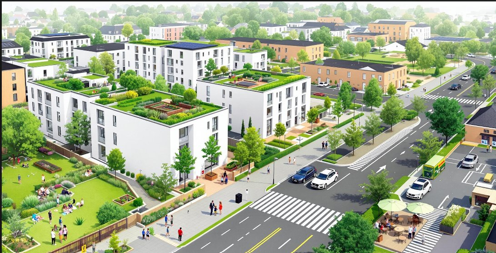

*Vision for Paul-Gerhardt-Allee (image generated with Artlist.io)*

---

## Contents

- [Project approach](#project-approach)
- [Study area](#study-area)
- [SWOT analysis](#swot-analysis)
- [Overall vision](#overall-vision)
- [1. Well-being and Quality of Life](#1-well-being-and-quality-of-life)
- [2. Climate Protection and Climate Change Adaptation](#2-climate-protection-and-climate-change-adaptation)
- [3. Resource Consumption and Waste](#3-resource-consumption-and-waste)
- [4. Socio-economic Profile](#4-socio-economic-profile)
- [5. Building Structure](#5-building-structure)
- [6. Blue and Green Infrastructure](#6-blue-and-green-infrastructure)
- [7. Mobility](#7-mobility)
- [8. Energy](#8-energy)
- [Synergies and conflicts](#synergies-and-conflicts)
- [Key takeaways](#key-takeaways)

---

## Project approach

The work combined site visits in May 2025, photo documentation, mapping, climate data analysis and a literature review. Each of the eight topics followed the same structure:

| Step | What it covers |
|---|---|
| **Status quo** | What the neighbourhood is like today |
| **Challenges** | The main problems found on site and in the data |
| **Vision** | A guiding statement and research question for the topic |
| **Actions** | Concrete measures, supported by examples from other cities |

At the end, the proposals from all topics were compared to find where they support each other (**synergies**) and where they compete (**conflicts**).

## Study area

PGA lies in Pasing in the west of Munich and is bordered by a railway line. The area was divided into four zones based on the type and age of its buildings:

| Zone | Description |
|---|---|
| **Old Residential Area** | Buildings from 1940–1980 with limited thermal insulation and inefficient heating; mature trees and hedges line the streets |
| **New Residential Area** | Dense, modern housing less than 10 years old, built to current energy standards, with a large new park and permeable paving |
| **Service & Corporate Area** | Mostly offices and services from the 1980s, plus newer childcare buildings; sparse vegetation |
| **New Real Estate Development** | Former railway land being converted into about 2,400 homes for around 5,000 new residents |

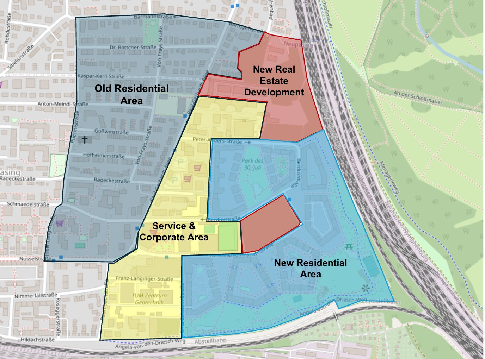

*The four zones of the study area (map data © OpenStreetMap contributors)*

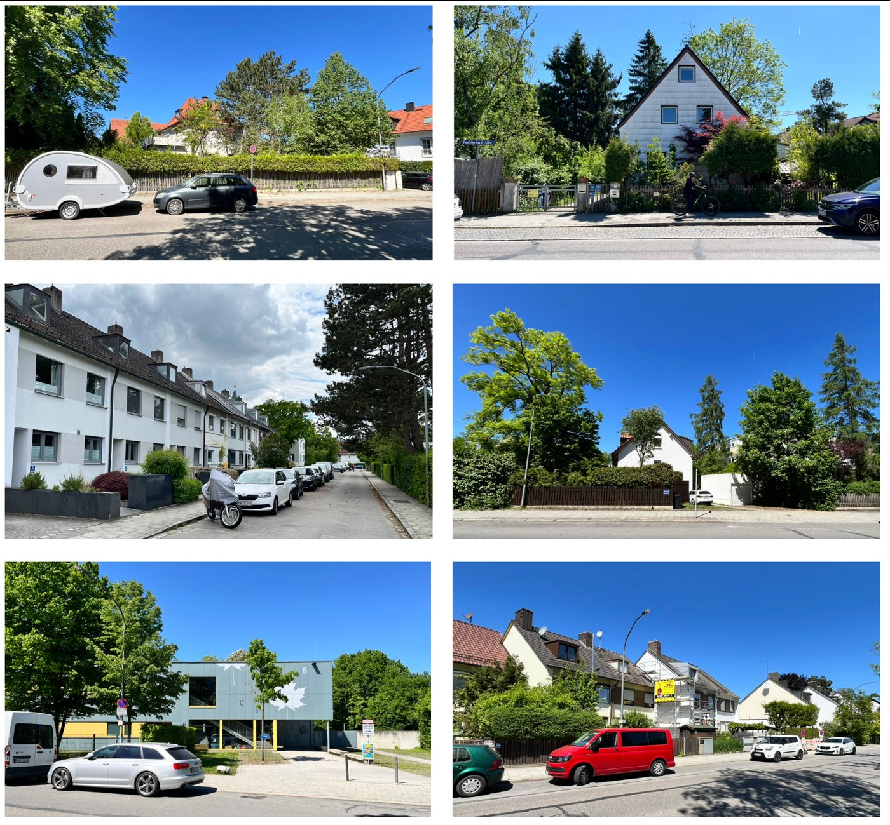

*Site visit photos of the Old Residential Area, May 2025*

Photos in this README were taken by the team during site visits, unless stated otherwise.

## SWOT analysis

The SWOT analysis was developed together through group brainstorming and site observations.

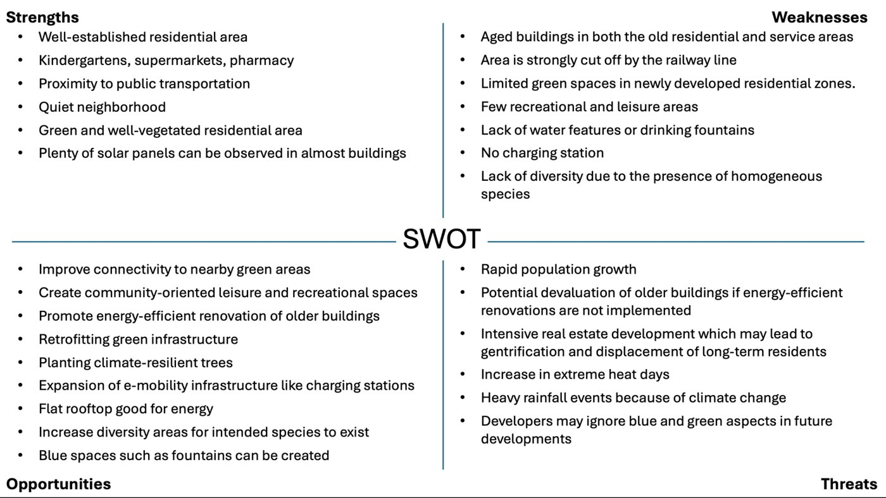

| | |
|---|---|
| **Strengths** | Good public transport, kindergartens and supermarkets nearby, quiet neighbourhood, green older streets, solar panels on many roofs |
| **Weaknesses** | Ageing buildings, the railway line as a barrier, little greenery and few leisure spaces in new areas, no water features or drinking fountains, no EV charging stations |
| **Opportunities** | Retrofitting older buildings, climate-resilient trees, rooftop energy, more biodiversity, fountains and other blue spaces |
| **Threats** | Rapid population growth, gentrification, more heat waves and heavy rainfall, new developments ignoring green and blue elements |

## Overall vision

PGA is seen as a *living, regenerative urban organism* where buildings, nature, people and resources work as one system:

- **Renovate, don't demolish:** older buildings from the 1940s–1970s are upgraded and connected with the new areas, honouring the area's history.
- **Shared green-blue network:** large private yards become part of a shared green and water system, with underground cisterns turning the area into a sponge city.
- **Rooftop energy grid:** roofs with good orientation carry more solar panels and share energy through a community microgrid.
- **People-first mobility:** walking and cycling come first, linked to clean, connected transport.
- **Integrated prosperity:** social inclusion, economic vitality and environmental regeneration support each other.

---

## 1. Well-being and Quality of Life

> **Vision:** *A sustainable, smart and community-led neighbourhood built for balance and eco-friendly urban living*
>
> **Research question:** How can inclusive design and shared public spaces help transform PGA into a socially connected, comfortable and people-centred neighbourhood?

**Status quo**

PGA is calm, with little traffic, low noise and open spaces. It has green patches and a playground, but these are basic and don't serve different age groups. Residents mostly use public spaces alone or with family, and there are no community boards, seating clusters or small events that bring people together.

**Challenges**

- Open spaces and the playground have no benches, shade or lighting, so they're barely used, especially in the evening
- Many spots feel hot and empty in summer because trees and cooling features are missing
- Poor road markings and missing walkways reduce accessibility
- Few places that build a sense of community and belonging

**Actions**

- **Conversation benches and talking zones:** "friendship benches" with prompts that invite strangers and older adults to start a chat
- **Outdoor fitness areas for all ages:** equipment for balance and strength, with soft surfaces and nearby seating for older users
- **Safe and stimulating play parks:** active and calm play zones, seating for parents, bike racks and trees
- **Shared community corners:** spaces where residents share stories and photos and meet for tea, crafts or games

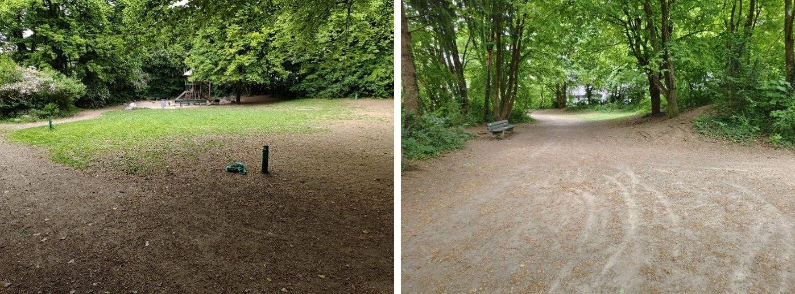

*Open spaces in PGA: a playground and a path with no seating, shade or lighting (site photos)*

## 2. Climate Protection and Climate Change Adaptation

> **Vision:** *Shared Settlement – One Green Climate Strategy*
>
> **Research question:** How can climate adaptation and climate protection use the contrast between old and new buildings as an opportunity rather than a conflict?

**Status quo**

Munich's climate data (solar radiation, temperature, cloud cover and rainfall) was analysed together with the microclimate on site. New buildings have green roofs, which are mandatory in Munich, but there are few green façades, young trees give little shade, and much of the ground is sealed.

**Challenges**

- About 68% of Germany's buildings were built before modern energy standards such as the EnEV, and this applies to the Old Residential Area
- Green façades are barely used despite their cooling, noise and CO₂ benefits
- Few plants on balconies and little shade from young trees
- Sealed surfaces lead to strong heat build-up, and there are no drinking fountains

**Actions**

- **Façade greening with planter troughs:** placed in front of the façade with built-in irrigation, so old buildings aren't burdened and fire safety is kept; planted with native, low-maintenance plants
- **Balcony greening** on new buildings, and green roofs combined with solar panels
- **Climate-resilient trees** such as the large-leaved lime for shade and CO₂ storage, keeping the existing young trees
- **Drinking fountains and a water playground** near playgrounds to cool people of all ages
- **Unsealing surfaces:** turning paved areas and supermarket car parks into lawn-grid paving
- **Low-carbon materials** such as wood in future buildings

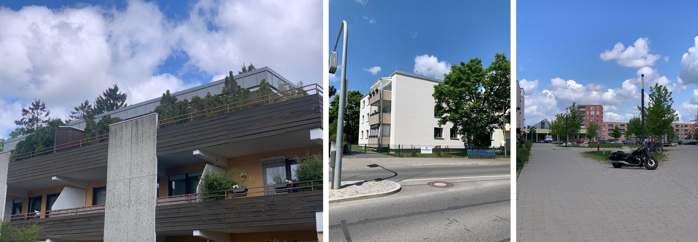

*Few plants on balconies, a south-west façade suitable for greening, and a sealed area that could be unsealed (site photos)*

## 3. Resource Consumption and Waste

> **Vision:** *PGA as a model for sustainable urban living with minimal resource use and effective waste management*
>
> **Research question:** How can PGA reduce resource consumption, manage waste effectively and adopt environmentally responsible design?

**Status quo**

Rapid construction is outpacing infrastructure. Many buildings still use conventional systems without smart metering, and resource-saving habits aren't well supported. Waste bins are outdated, unevenly placed and often overfilled.

**Challenges**

- Unplanned urban growth and rising demand for water, energy and materials
- Public services under pressure from the growing population
- Inefficient waste collection and sorting

**Actions**

- **Smart urban planning:** dense, transit-oriented, resource-efficient design; alternative construction materials and natural daylighting
- **Resource efficiency:** smart grids, better insulation and glazing, and smart water-saving technology
- **Infrastructure upgrades:** renewable energy, replacing ageing pipes and grids, real-time leak detection
- **Better waste management:** sorting at source, a smart waste system, new and better-placed waste bin locations, recycling and composting
- **Circular economy:** reuse, repair, upcycling, durable design and producer responsibility

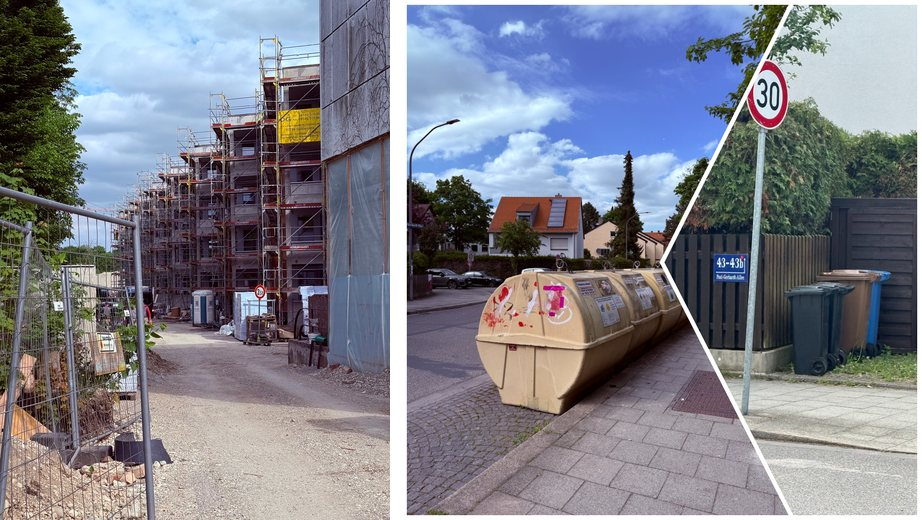

*Conventional construction on site and outdated, overfilled waste bins (site photos)*

## 4. Socio-economic Profile

> **Vision:** *A stable triangle of prosperity, inclusion and sustainability*
>
> **Research question:** What key strategies should PGA adopt to promote common prosperity, social inclusion and sustainability?

**Status quo**

PGA is a recent residential development that is still being built. Most residents work in high-paying sectors such as finance, technology and law, and incomes are well above the Munich average. Demand for housing is high and supply limited, so property prices and rents keep rising.

**Challenges**

- **Housing affordability:** rising rents can push out long-term residents and lead to gentrification
- **Lack of social infrastructure:** few cafés, restaurants or community centres where neighbours can meet
- **School capacity:** schools currently have more places than there are local children

**Actions**

- **Balanced housing mix:** rental, mid-range and affordable homes, backed by schools, transport, healthcare and parks
- **Community hubs:** cafés, restaurants and community centres as informal meeting places
- **Repurposing unused school space:** temporary family centres, language classes or youth programmes until more families move in

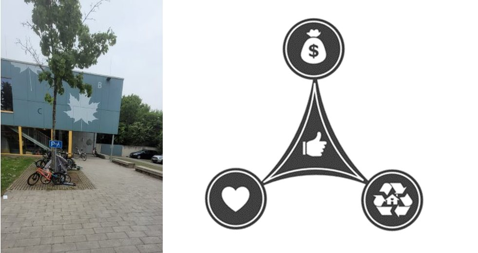

*A kindergarten in PGA, and the triangle of prosperity, inclusion and sustainability*

## 5. Building Structure

> **Vision:** *Structures that build a resilient and inclusive future*

**Status quo**

The four zones differ strongly. Old buildings have poor insulation and inefficient heating, while new buildings meet current standards. Large construction projects are still under way in the new development area.

**Challenges**

- Old structures with high energy demand; renovation is held back mainly by cost
- Construction sites cause noise, dust and diesel exhaust for current residents
- Many large private gardens in the old area are underused

**Actions**

- **Bringing old buildings into the new era:** insulation, heat pumps and solar panels, with government credit programmes so owners can renovate quickly
- **Minimising construction impacts:** materials like engineered wood, plus daylighting, natural ventilation and early involvement of residents
- **Sharing the greenery:** incentives to open private green spaces for community gardens, rainwater storage and leisure, following Munich's *Krautgärten* model

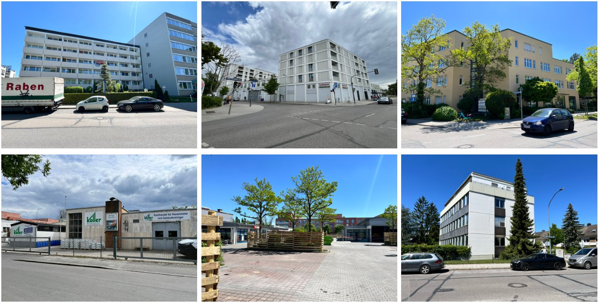

*Office and service buildings in the Service & Corporate Area, mostly from the 1980s (site photos, May 2025)*

## 6. Blue and Green Infrastructure

> **Vision:** *Blue spaces, green spaces, safer places*
>
> **Research question:** How can blue and green infrastructure maximise ecosystem services, create a climate-adapted landscape and connect people and nature through inclusive design for plants and animals?

**Status quo**

The old area has large trees and hedges that give good shade. The new area has a large, recently planted park with open meadows and permeable paving. The service area has very little vegetation. Biodiversity is low overall, and there are no water features.

**Challenges**

- **Disconnect from water:** no blue spaces or cooling points, and rainwater isn't collected
- **Low biodiversity:** few habitats for plants and animals
- **Sealed surfaces and limited shade** increase the urban heat island effect
- **Climate risk** from floods and heat waves

**Actions**

- **Animal-Aided Design:** nesting boxes, sand and water baths, and green roofs and façades to attract birds and insects, linking to the nearby Nymphenburg Palace Park
- **Water management:** detention areas in the meadows for heavy rain, swales, permeable walkways, shared rainwater tanks and possibly a decentralised wastewater treatment plant
- **Greener environment:** green roofs and façades in the service area, rooftop urban farming and a community garden in the park

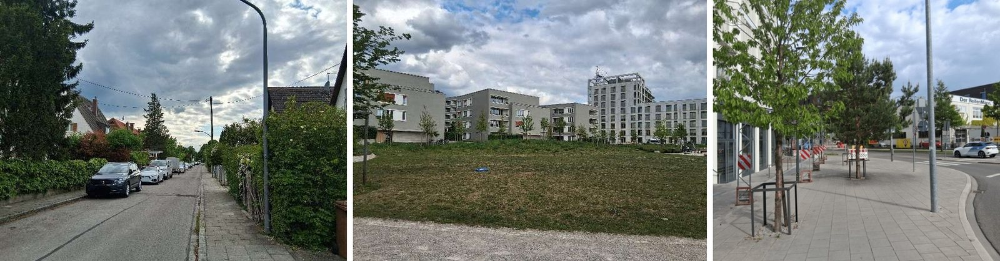

*Tree-lined street in the Old Residential Area, open meadows in the new park, and recently planted street trees (site photos)*

## 7. Mobility

> **Vision:** *Clean Moves and Connected Lives – Mobility that works for Everyone*
>
> **Research question:** How accessible and safe is mobility in PGA for all users, including children, older people and people with strollers or disabilities?

**Status quo**

PGA has good public transport, with nearby S-Bahn access and bus lines, and a new S-Bahn stop is planned. Many residents walk or cycle, but streets are shared by cars, bikes and pedestrians without separate lanes. There are no public EV charging stations.

**Challenges**

- Congestion and conflicts between road users on shared paths
- Streets crowded with on-street parking
- No EV charging infrastructure
- Limited public transport at night

**Actions**

- **Separated lanes** for pedestrians, cyclists and strollers, with clear signs and markings
- **Modular or multi-level parking** to free up street space
- **EV charging stations:** on-street chargers, wall boxes in new buildings and fast chargers at community centres and supermarkets
- **Better public transport:** more frequent off-peak and night services, plus on-demand transport

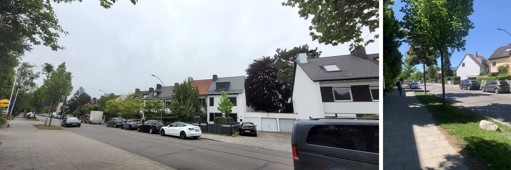

*Streets crowded with on-street parking and a shared path for pedestrians and cyclists (site photos)*

## 8. Energy

> **Vision:** *Smart neighbourhood with sustainable future*
>
> **Research question:** How can renewable energy, building retrofits and smart technologies turn the contrast between old and new buildings into an opportunity for energy sustainability?

The energy vision uses the mix of old and new buildings in PGA as a strength. The goal is a clean, efficient and inclusive energy system that supports climate targets and everyday comfort, by increasing solar energy, upgrading older buildings and using smart technology to cut energy use and emissions across the whole neighbourhood.

**Status quo**

- **Energy supply:** many buildings are connected to Munich's district heating network, run by Stadtwerke München (SWM). It uses combined heat and power (CHP), which is much more efficient than older heating systems. Part of the energy still comes from natural gas, but SWM plans to switch fully to renewable energy by 2040, in line with Munich's goal of climate-neutral neighbourhoods.
- **Solar energy:** during the site visits, rooftop solar panels were found on many buildings, showing that residents are already open to renewable energy.
- **Older buildings:** in the Old Residential Area, some buildings lack proper insulation, have old windows and use inefficient heating or cooling. This leads to high energy use and less comfort for residents. Research by the Buildings Performance Institute Europe shows that renovations such as better insulation, new windows and improved ventilation can cut a building's energy use by up to 80%.

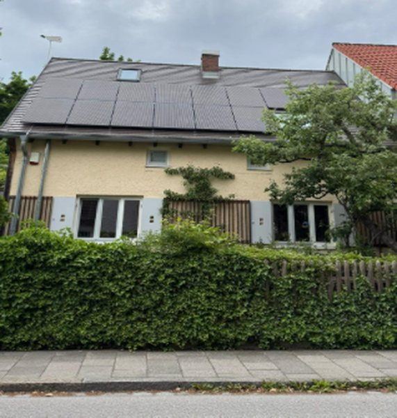

*Rooftop solar panels on an older house in PGA (site photo)*

**Challenges**

- **Limited smart energy monitoring:** even many new, efficient buildings lack smart meters, energy dashboards and automation. Without them, residents and building managers can't track or optimise energy use, so even efficient buildings can perform poorly in practice. Germany has been slow to roll out smart meters, with targets now set for 2030, and PGA shows this gap at neighbourhood scale.
- **High energy demand in older buildings:** poor insulation, single-pane windows and outdated heating cause heat loss in winter and overheating in summer, leading to high energy bills and weaker overall performance of the district.
- **Reduced passive cooling:** newer buildings often have large glass façades, no external shading and are built close together, so they overheat quickly in summer. Trees, green roofs and water features are limited, which increases reliance on energy-intensive cooling. Studies show passive cooling can lower energy demand by over 40% in hot weather.

**Actions**

1. **Retrofit old buildings with energy-efficient technologies**
   Upgrade the older blocks with modern insulation, new windows and high-efficiency heating, ventilation and air conditioning (HVAC). Deep retrofit projects in Europe have saved 60–80% of energy, even in buildings that are decades old. The EU *HERB* project (Holistic Energy-efficient Retrofitting of Residential Buildings) showed that façades can meet current energy standards while keeping their heritage features. This lowers residents' energy bills, improves comfort all year round and reduces CO₂ emissions without building new.

2. **Shared battery storage in residential blocks**
   Install shared batteries in apartment buildings so rooftop solar power can be stored and used after sunset. In the White Gum Valley housing project in Australia, combining solar panels with shared batteries in a microgrid reached over 60% self-sufficiency and greatly reduced electricity from the grid. In PGA, pooling storage at block level would make better use of solar power, balance electricity loads and support residents during power cuts or peak prices.

3. **Green roofs and green façades**
   Add plants to roofs and building walls. Studies show green roofs can cut cooling loads by 20–50% in temperate climates, reduce heat transfer through roofs and walls, reduce the urban heat island effect and make roofs last longer. Basel's green roof requirement and Barcelona's façade greening strategy are successful examples. In PGA, green roofs and vertical gardens would keep buildings cooler naturally and lower peak electricity demand.

**Conclusion**

PGA has already made good progress, especially with solar panels and its connection to district heating. The next steps are renovating older buildings, introducing smart energy monitoring and using passive cooling. Combining building renovation, renewable energy and smart technology, in line with Munich's climate goals, could make PGA a model for low-emission urban development.

---

## Synergies and conflicts

The proposals were compared to see how they affect each other.

**Synergies**

- **Social interaction:** shared spaces, community hubs and community gardens all bring residents together
- **Energy savings and biodiversity:** green roofs cut cooling demand and also create habitats for insects
- **Lower CO₂ emissions:** tree planting and EV charging both reduce emissions

**Conflicts**

- **More sealed surfaces:** new separate lanes for road users work against unsealing measures
- **Housing affordability:** energy retrofits can raise rents and lead to gentrification
- **Resident comfort:** more wildlife and insects may bother some residents

## Key takeaways

- The contrast between old and new buildings is treated as an **opportunity**, not a problem.
- Renovating existing buildings is preferred over demolishing them.
- Green and blue infrastructure links climate adaptation, biodiversity, energy savings and well-being.
- Measures must be planned together, because some, like retrofits and new lanes, can create new problems.

---

## Team

This project is a group work by:

Graham Badebye Ndiko, Shijil Adikkool, Arya Aji, Akshay Maru Veettil, Maike Schütz, Paulo Siqueira, Mariya Vettussery Thadevoos, Krishna Vinod

Supervisor: Doris Bechtel, Chair of Energy Efficient and Sustainable Design and Building, TUM
